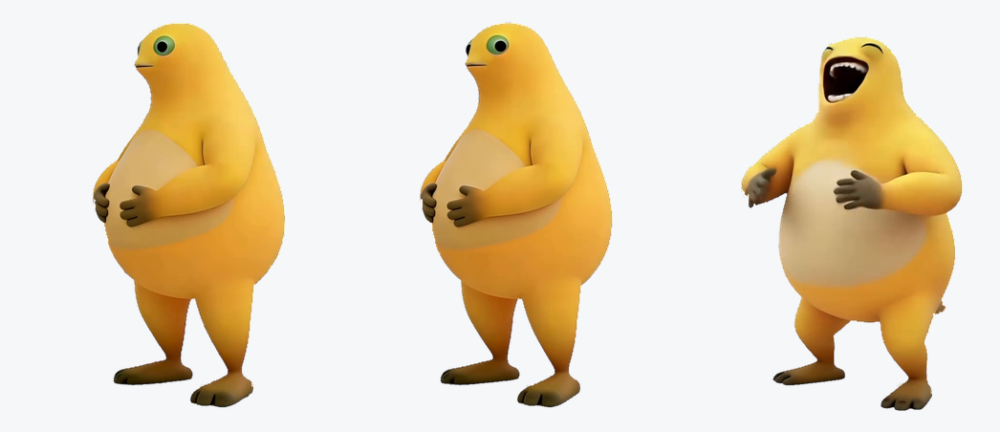

# 奶蛙桌宠



一只从视频里抠出来的 Windows 桌面宠物：643×824 的奶蛙，438 帧 @30fps，
逐像素 alpha 的透明窗口贴在桌面上，双击就笑，戳肚子会凹下去。

纯 C# / WinForms 单文件源码，**零第三方依赖**，素材全部随仓库走。

## 下载

不想编译的话，仓库里就有一份编译好的 `naiwa_pet/pet/奶蛙.exe`，把它和同目录的
`frames/`、`naiwa.wav` 放在一起就能跑。

想要现成的整包，就去 [Releases](https://github.com/tzshuai07/naiwa/releases) 下最新的
`naiwa-pet-v1.0.0.zip`，解压后直接双击 `奶蛙.exe`。

会弹一次 UAC，点「是」——原因见下面「启动」一节。

需要 .NET Framework 4.0 或更高（Windows 10 / 11 自带 4.8），不用另外装运行时。

## 目录结构

| 路径 | 内容 |
| --- | --- |
| `naiwa_pet/pet/NaiwaPet.cs` | 源码（C# / WinForms，61 KB，单文件） |
| `naiwa_pet/pet/奶蛙.exe` | 编译好的主程序（92 KB，.NET Framework 4.0+） |
| `naiwa_pet/pet/frames/` | 程序用的 438 张 PNG，322×412（0.5 倍，已预乘 alpha） |
| `naiwa_pet/pet/naiwa.wav` | 程序播放的音频，16bit PCM 立体声 44.1kHz |
| `naiwa_pet/pet/naiwa.ico` | 托盘 / 窗口图标（取第 0 帧裁到 alpha 外框） |
| `naiwa_pet/frames_30fps/` | 438 张 RGBA WebP，643×824，原始尺寸素材 |
| `naiwa_pet/audio/naiwa.m4a` | 原视频音轨（HE-AAC 流拷贝，79,553 字节） |
| `naiwa_pet/naiwa.mp4` | 原始视频 |
| `docs/preview.png` | 上面那张预览图 |

素材是 438 帧 @30fps、643×824 的 RGBA WebP，去掉了白边和脚下的影子，
音频转成 m4a 后又转成程序内可直接播放的 PCM。

## 从源码构建

源码没有 `.csproj`，直接用系统自带的 `csc` 编：

```powershell
cd naiwa_pet\pet
C:\Windows\Microsoft.NET\Framework64\v4.0.30319\csc.exe /nologo /target:winexe /unsafe `
    /win32icon:naiwa.ico /out:奶蛙.exe `
    /r:System.Windows.Forms.dll /r:System.Drawing.dll NaiwaPet.cs
```

`/unsafe` 是必须的（逐像素渲染用了指针）。重新编译会直接覆盖仓库里那份 `奶蛙.exe`。

`NaiwaPet.cs` 开头还留了两个调试入口：

```
奶蛙.exe                运行
奶蛙.exe --selftest f   把第 f 帧渲染到假的桌面上，存 PNG
奶蛙.exe --capture  f   短暂延迟后截屏，存 PNG
```

## 启动

双击 `奶蛙.exe`，会弹一次 UAC，点「是」。

**为什么需要管理员权限（UIPI）**：托盘图标注册走 `Shell_NotifyIcon`，它要向 explorer 的通知区域
发消息。Windows 的 UIPI 禁止低完整性进程向更高完整性的窗口发消息，被拒时返回
`ERROR_ACCESS_DENIED(5)`。进程**无法自己提升完整性级别**，所以程序在检测到注册失败（`err=5`）
且当前不是管理员时，会用 `runas` 重启自己一次；提权后实测 `add=True err=0`，图标正常出现。

不想每次弹 UAC，可用「任务计划程序」建一个「以最高权限运行」的登录启动任务指向 `奶蛙.exe`。

启动后程序会写 `tray.log`，记录这次托盘注册自检的结果：

```
probe   : add=True err=0 cbSize=976 hIconNull=False
winforms: Visible=True IconNull=False
elevated: True relaunchFlag=True
```

## 交互

| 操作 | 行为 |
| --- | --- |
| **双击** | 两下间隔 < 200ms 才算双击：从当前帧开始按 30fps 播放整段动画，音频同步 |
| **鼠标悬停** | 按 60fps 静音播到第 45 帧后停住；移开按 60fps 倒回第 0 帧 |
| 悬停中双击 | 从第 45 帧接着按 30fps 播，音频按 `帧/30` 跳位对齐 |
| **单击肚子** | 局部弹性形变：轮廓向内收、带阻尼回弹，420ms 复原 |
| 拖动 | 移动这只奶蛙 |
| 右键 | 弹出菜单 |

## 单击肚子：局部弹性形变

- 位移场是**径向缩放**：`src = center + v × (1 + k·w)`，`w` 是 smoothstep 衰减权重
- `k(t) = 0.22 · e^(-8t) · cos(17t)`
  - **k > 0 时轮廓向内收**（采样点被推到更外侧，边缘采到透明 = 凹陷）；`k < 0` 才是往外鼓
  - 频率 17、衰减 8：响应快、收得快、回弹一次半就停
- 影响半径 = `0.30 × 窗口宽`（100% 档约 97 px），换档位自动等比
- **只有中部左侧生效**：判据是帧坐标里的椭圆（中心 0.45W / 0.45H，半径 0.27W / 0.25H，
  即帧像素 x 58–232、y 82–288）+ 该点 alpha ≥ 100。中心/半径参考了住户在 `1.png` 上标出的红色区域
  （标记图按 0.573 缩放、偏移 (25.3, 10.7) 对齐到第 0 帧，提取红色像素求包围盒），再向左下扩了一圈，
  让「中部左边整块」都能触发。颜色判据行不通——这只奶蛙没有独立奶白肚皮，最浅区域只是胸口高光
- **按下即触发**（`OnMouseDown`），不是松开时触发：真实鼠标点击时手会抖几个像素，
  而拖动判定只要移动超过 4px 就 `return`，导致形变被「吃掉」。改成按下即凹之后，
  即使随后变成拖动也不取消形变（只有双击才取消）
- 播放动画期间单击不触发，避免和 30fps 抢帧
- 逐像素反向映射 + 双线性采样，预乘 alpha 在同一次遍历里完成

**双击间隔自己判定（200ms）**：原来用自定义的 350ms，但 WinForms 内建的 `OnDoubleClick` 仍按系统设置
（默认 500ms）派发，所以两边都得管。现在判定完全挪到按下时（`DOUBLE_MS = 200`），`OnDoubleClick`
里的播放逻辑已删除，系统那 500ms 窗口不再生效。

实测（两下按压间隔 vs 之后的画面变化量，`max_tail` 大说明正在播放动画）：

| 间隔 | 尾部帧变化量 | 结果 |
| --- | --- | --- |
| 120ms | 19114 | 判为双击，播放动画 |
| 450ms | 816 | 不判双击，只做两次凹陷 |

**坐标坑（重要，已修正）**：曾经以为 `MouseEventArgs.Location` 被 DPI 放大了 1.5 倍，于是除以 1.5，
结果把点击点整体挪到左上，用户感觉「判定区偏右偏下」。实测日志证明：**真实鼠标点击时
`e.Location` 就等于物理客户区坐标**（`eLoc={153,176}`，`cursorClient={153,176}`，窗口 322×412）。

那个 ×1.5 只出现在 `PostMessage` 模拟点击时（消息绕过了 OS 的正常路径），是测试手段的假象。
现在直接用 `e.Location`，不再做任何换算。

实测（真实坐标，`belly` 为程序内部判定结果）：

| 目标点 | belly | 说明 |
| --- | --- | --- |
| (99,181) 左肚皮 | True | |
| (153,176) 中心 | True | |
| (150,241) 下肚皮 | True | |
| (199,200) 右肚皮 | True | |
| (150,301) 肚子下沿外 | False | 下边界 ≈ 288 |
| (150,61) 头部 | False | |
| (159,350) 大腿 | False | |

实测（60fps 连续录制 48 帧，与静止帧的差异像素数）：

| 帧号（1/60 秒） | 差异像素 | 状态 |
| --- | --- | --- |
| 0-8 | 0-88 | 静止 |
| 9-14 | 193-277 | 开始凹陷 |
| 15-18 | 2742 / 2745 / 1374 / 1298 | 凹陷峰值 |
| 20-27 | 1073 → 895 | 回弹 |
| 28-36 | 523 → 195 | 收尾 |
| 37-47 | 62 | 复原（62 是背景噪声基线） |

凹陷持续约 `(36-15)/60 ≈ 0.35 s`，与 `POKE_MS = 420` 相符。

只有肚皮生效（按下后 60fps 录制 30 帧的峰值差异）：

| 按下位置 | 峰值差异 | 结果 |
| --- | --- | --- |
| 肚子中心 (153,176) | 6965 | 触发 |
| 肚子上缘 (150,100) | 2278 | 触发 |
| 肚子左侧 (95,180) | 2819 | 触发 |
| 双手 (130,220) | 3526 | 触发（在标记范围内） |
| 大腿 (160,350) | 0 | 不触发 |
| 头部 (150,53) | 252 | 不触发（噪声） |

边界处（解析计算，`d≤1` 为命中）：肚子下缘 (150,300) `d=1.90` 判 out、
右侧胯部 (240,260) `d=2.20` 判 out——和标记图里椭圆的下沿、右沿一致。

## 大小档位（每只独立）

右键 →「大小 ▸」，三档 **100%（最大）/ 80% / 60%**，当前档位带勾。

- 只影响被操作的那一只
- 「再来一只」出来的新奶蛙**继承被右键那只的大小**；托盘「增加一只」固定 100%
- 窗口尺寸 = 322×412 × 档位，素材不重新导出
- 换档时**右下角锚定**，脚仍踩在原位
- 透明命中按比例反算回原图坐标，缩小后点击/悬停仍精确
- 每只只多占一块**复用**的缩放缓冲（约 0.5MB），不是每帧新建

实测（同一只依次切档，统计屏幕上的黄色像素面积）：

| 档位 | 像素数 | 相对 100% | 理论值 |
| --- | --- | --- | --- |
| 100% | 34,818 | 1.000 | 1.000 |
| 80% | 22,244 | 0.639 | 0.64 |
| 60% | 12,554 | 0.360 | 0.36 |

## 右键菜单

| 菜单项 | 行为 |
| --- | --- |
| 播放一遍 | 从第 0 帧完整播放 |
| 再来一只 | 新奶蛙继承这只的大小 |
| 大小 ▸ | 100% / 80% / 60% |
| 删掉这一只 | 只结束这一只（≥2 只时出现） |
| 仅保留这一只 | 结束其它所有（≥2 只时出现） |
| 全部大笑 | 所有奶蛙一起播 |
| 退出 / 退出全部 | 结束进程 |

## 托盘

右键托盘图标：

- **增加一只**（100% 大小）
- **全部大笑**
- 关掉所有奶蛙（结束所有窗口，**进程保留**，托盘图标还在）
- 退出奶蛙（结束进程）

## 音频

- 每只奶蛙**独立**一个 `waveOut` 设备，独立播放；删掉某一只不影响其它只的声音
- 进度来自 `waveOutGetPosition`（`TIME_SAMPLES`），帧号 = `floor(位置秒数 × 30)`
- 不做音量缩放，多只同时笑会叠加超过 0dBFS

## 崩溃修复记录

多只奶蛙轮流双击时曾报 `ArgumentException: 参数无效`。根因是共享帧缓存的 LRU 淘汰会
`Dispose` 掉仍被其它窗口使用的位图。修法是按索引引用计数（`s_use`，`rc > 0` 时跳过淘汰）
并在 `AlphaAt` / `Push` 加空值保护。修前 10ms 探针 23 次失败 / 3692 次探测，修后 0 次失败，
内存稳定在 113.5→113.7 MB。

## 已知限制

- 多显示器时固定出现在主屏右下角
- 动画播放期间不能单击形变（避免抢帧）
- 托盘图标需要程序以管理员权限运行，这是 UIPI 限制，程序无法绕过

## 素材处理备忘

- 抠图去掉了白边和脚下阴影，只保留主体
- 第 396/397 帧原本主体缺失，已在 `frames_30fps/` 和程序用的 `frames/` 里修好
- 原视频本身是 30fps；438 对相邻帧里 438 对完全字节相同，所以按 438 帧 @30fps 输出，不重复帧

## 许可

[MIT](LICENSE) © 2026 ZiSTian
